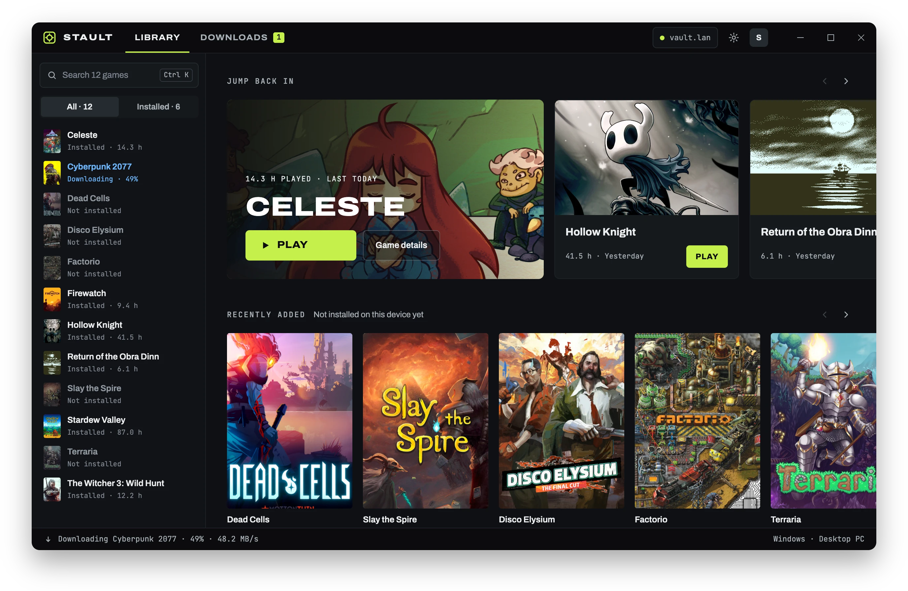
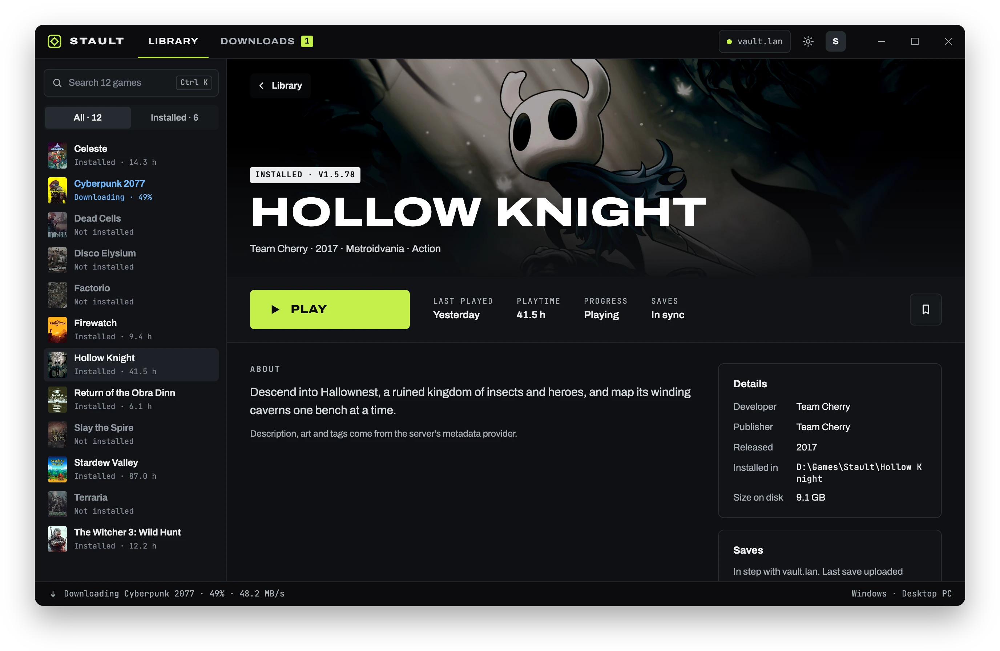
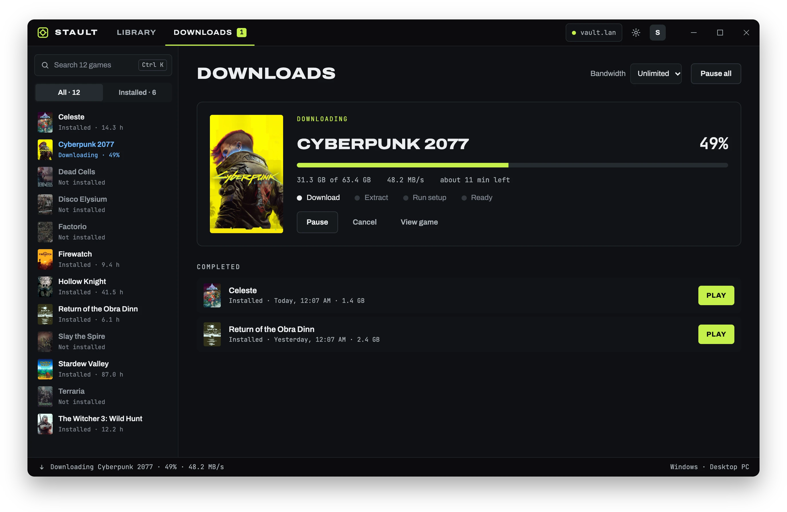

<div align="center">


# Stault

**The launcher your [GameVault](https://gamevau.lt) server deserves.**

A Steam-style desktop client for your self-hosted game library.<br>
Browse, install, play and sync saves on Windows, macOS and Linux.

[](https://github.com/MoSattler/stault/releases/latest)
[](https://github.com/MoSattler/stault/releases)


[Install](#install) · [Features](#features) · [Save sync](#save-sync) · [Contributing](CONTRIBUTING.md)



</div>

> [!IMPORTANT]
> Stault is alpha software. Expect bugs and rough edges, and keep a backup of any saves you care about.
>
> Bug reports and contributions are very welcome. If something breaks, please [report it](https://github.com/MoSattler/stault/issues/new?template=bug_report.yml). To help with code, start with [CONTRIBUTING.md](CONTRIBUTING.md).

## Features

- **Your whole library.** Recently played, recently added, search, and a page per game with the art and details from your server.
- **Installs that take care of themselves.** A download queue with pause, resume and a bandwidth limit. It picks up where it left off after a restart.
- **Play and keep count.** Stault launches the game and records your playtime on the server.
- **Saves that follow you.** A newer save is fetched before the game starts, and yours is uploaded after you quit.
- **Sign in once.** With a password, or through your server's single sign-on in your web browser. The session token is kept in the system keychain. The password is never stored.

<p align="center">


</p>

## Install

You need a GameVault server, version 17.0 or newer. Single sign-on needs 17.3.

**macOS** (Apple Silicon, macOS 14 or newer)

```bash
brew install --cask mosattler/tap/stault
```

**Linux** (x64)

```bash
curl -fsSL https://github.com/MoSattler/stault/releases/latest/download/linux-x64-Stault-Setup.tar.gz | tar -xz -C /tmp && /tmp/installer
```

This installs Stault into `~/.local/share` without root, adds it to the application menu and starts it. Run it again to upgrade.

**Windows**: download the installer from the [latest release](https://github.com/MoSattler/stault/releases/latest).

## What runs where

| | Launches |
| --- | --- |
| Windows | Windows builds |
| Linux | Linux builds natively, Windows builds through [umu-launcher](https://github.com/Open-Wine-Components/umu-launcher), which comes with Stault and needs Python 3. Ubuntu 24.04 and later may also need umu-launcher's own package; Stault tells you if so. |
Stault is used on macOS; on Linux and Windows it has so far only been run in test machines (a container, and a VM with Windows for Arm), not on a Steam Deck or a gaming PC.

Not built yet: Big Picture Mode, Steam shortcuts.

## Save sync

Before a game starts, Stault fetches a newer save from the server; after you quit, it uploads yours. The game's page shows where its saves stand and has buttons to move them by hand.

The server has to accept save files: set `SAVEFILES_ENABLED=true` on it and give `/savefiles` a volume. They are off by default.

<details>
<summary>How it behaves</summary>

- [Ludusavi](https://github.com/mtkennerly/ludusavi), bundled with Stault, finds the save files. When Stault matches no entry or the wrong one, choose it on the game's page. For a game Ludusavi doesn't list, choose its save files and folders there yourself; each device needs them once.
- To leave one game's saves alone, turn sync off in its properties (the gear on its page).
- Offline, a game starts with the saves on the device, and saves made meanwhile are uploaded once the server is back.
- When saves changed on two devices, Stault asks which to keep. It never overwrites a save it has not seen on either side.
- Saves use the format of the official GameVault client, so a Windows build's saves move between it and Stault, and between Windows and Linux. A Mac build's saves only move between Macs.
- Only the newest save on the server can be fetched. The server keeps older ones (10 by default) on its disk.

</details>

## Contributing

Stault is built with [Electrobun](https://docs.electrobun.dev/electrobun/) 2 (Bun main process, system webview), React, Tailwind CSS and Vite. With [Hutch](https://docs.electrobun.dev/electrobun/guides/hutch/) installed:

```bash
hutch run install
```

```bash
hutch run dev:hmr
```

Tasks, the test server, the code layout and how releases work are in [CONTRIBUTING.md](CONTRIBUTING.md). Design boards are in [design/](design/README.md).
